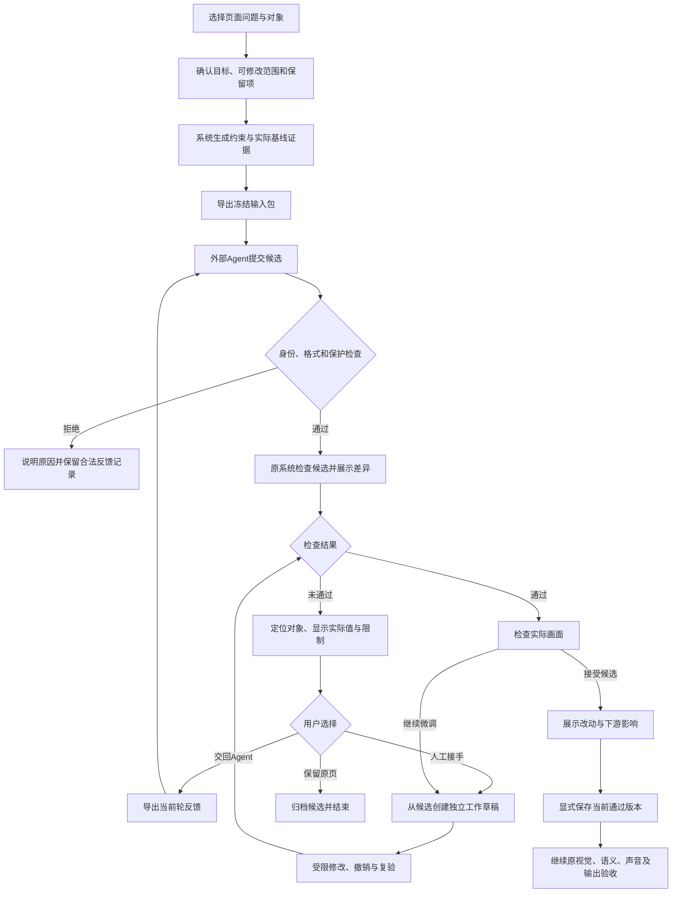

# 外部Agent输入与人工接手优化方案

## 一、业务流程



## 二、当前事实与本方案状态

本文件是开发方案，未接入生产，不替代现行合同，也不升级API或已冻结任务身份。附带JSON和Agent指令是待接入的输入设计示例，不能直接导入当前接口。现行基线为执行合同2.0、任务/结果0.2.0、契约0.9.100/API1.54。

本轮只读核对了实际导出、导入、原播放器和人工编辑器；没有调用外部Agent或付费模型，没有修改作者、音频和批准。

### 2.1 真实失败说明

Token第3页首轮外部结果只改from/to字号17→22。可信便携预检通过，原系统准备候选时拒绝容量；共享诊断进一步确认两处标签均为实际高度48.0000098px、上限44px、容差1px。终态诊断图未见明显压盖，但诊断图不能替代正式容量通过。原系统未保存，revision保持1。

原因包含三层：

| 层次 | 实际问题 | 对策 |
| --- | --- | --- |
| 参数联动 | 22px行盒加上下内边距与边框后约48px，组件内部仅允许44px | 同时检查字号、内部分配、整体框和保留入场位移 |
| 输入语义 | 输入已有`text_measurements.height=44`，但原measure成功返回的是预算，并非实际DOM外框高度；标签内部padding等仍在renderer中 | 明确拆开actual、limit、tolerance和测量口径，输出原组件推导的限制 |
| 工具边界 | 便携工具只有生产静态操作/AJV/compiler，没有浏览器容量 | 显示检查覆盖，提供原系统反馈或可选同源预览工具，不能将结构通过升级为排版通过 |

### 2.2 已有能力与缺口

| 当前能力 | 已实现事实 | 本次需要补什么 |
| --- | --- | --- |
| 输入导出 | 原文、截图、PNG、风格、动作、Schema、约束与官方结构工具 | 目标表单、内部容量、精简决策视图和证据语义 |
| 业务验收 | 后端ExportRequest支持font_requirements、overlap_pairs | 普通网页目前只传goal/scope和严格开关，未提供这两项的填写界面；测试脚本的强条件不能代表普通用户入口已有 |
| 输出导入 | 安全读取ZIP，核对身份与严格验收，调用原repair，显式保存 | 可读问题面板、失败诊断、人工接手草稿 |
| 人工编辑 | 属性编辑、拖动缩放、会话撤销重做、共享播放器、revision冲突和叶字段保护 | 导入候选到草稿的桥接、来源混合记录、可恢复工作记录 |
| 失败显示 | 目前主要展示JSON和错误文字，失败候选不能保存 | 点击问题定位对象，查看预算/实际值，可继续改草稿 |
| 草稿与恢复 | 编辑器Map保留会话内草稿，撤销栈最多50；保存后重置撤销栈 | 跨刷新工作草稿及保存前检查点，不能将会话撤销宣传为已保存版本恢复 |

## 三、导出输入页面

**入口来源：**当前页面编辑器的“外部Agent”区域，沿用已选择对象；设计参考页保持独立的只读设计交接入口。

### 3.1 用户确认任务

用三步表单替代仅填写一段goal：

1. **问题与结果：**选“文字太小、排版拥挤、对象遮挡、动画时机、其他”，补一句目标。类型只提供表单建议，不自动确定真假问题。
2. **明确范围：**展示直接修复对象、允许联动布局对象、只读上下文对象。前两者都必须经用户确认并落到服务器scope；“附近对象”不自动获得编辑权限。
3. **验收与保留：**填写明确阈值，确认不可变项，查看本次检查能力，再导出。

本例表单应能选底栏from/to/takeaway各≥22px，勾选原文、heading可见、主题、素材、讲稿和全部动作保持，确认必要时可调整底栏/三张卡的注册位置与尺寸。

文字目标不能静默变成机器条件。系统可以提出“你是否要求至少22px”的候选解释，最终以用户可见的结构化条件为准。没有阈值时导出明确的人工验收条件，不能声称已实现自动目标验证。

### 3.2 导出前状态

- **有未保存草稿：**保留现有规则，用户选择保存当前页、返回编辑或显式舍弃；导出不能暗中保存草稿。
- **原页合法：**捕获原播放器基线证据、测量和冻结身份，完成后再次核对版本。
- **原页容量已失败但结构/资源合法：**新增“导出问题页修复包”；仅使用原共享诊断模式取证，标记baseline_failed，不伪造正式基线通过。此能力现阶段未实现，属于P1。
- **原文、资源、身份或必需声音缺失：**说明缺哪项及其入口，阻止相应任务。不能用诊断模式绕过结构/资源检查。
- **动态任务没有真实音轨：**保持阻断。静态任务允许作者时钟，包内显式说明音频未验。
- **导出期间输入变化：**取消该次包，保留表单，重新读取当前版本。

### 3.3 验收条件表单

字号条件提供对象、公开文字部位、最低字号；显示当前实际显式字号与继承值来源。自动验证对象scope与part合法性。
首期保持现有“作者显式字号下限”的机器验收语义，继承值供说明；若后续要改成最终计算字号，须另行定义并验证，不能在兼容接口里静默转换。

遮挡条件展示对象对、允许容器关系、检查区间和采样范围。可由注册策略提出建议，用户可查看；禁止默认全页两两检测，避免将主体/图框的正常重叠判错。

包内写出“指定对的有限采样”，不能显示为“全片无遮挡”。没有pair时明确“未配置对象对检查”。

## 四、新版输入包

### 4.1 一个权威输入，两个阅读视图

保留完整机器输入与hash作为校验事实；由同一导出器生成面向Agent的决策摘要。摘要只引用权威字段，不维护第二套人工规则。

| 材料 | 支持的决策 | 推荐处理 |
| --- | --- | --- |
| ENTRY.md | 任务、步骤、工具边界、交付与停止条件 | 唯一执行入口，避免多份相互重叠的说明 |
| decision-input.json | 当前要修什么、可改什么、如何判定 | 只放scope对象及必要邻接信息，指回权威源位置 |
| task.json/content.json | 原文、完整身份、完整scene/binding、官方Schema | 保留权威全量，工具按引用读取 |
| constraints.json | 原组件推导的内外边界、联动限制 | 机器可读，单位和来源明确 |
| evidence/ | 理解原图及核对问题 | 原截图+必要问题局部图，保留时间、坐标变换和来源；局部图不是新坐标真值 |
| tools/ | 确定性校验、可选同源预览 | 每项明示覆盖，不带凭据 |
| templates/ | result/verification/report | 从当前模型派生，仅一套格式口径 |
| contracts/ | 完整规范与能力来源 | 封存版本以供查阅，ENTRY引用准确段落，不再重复抄写 |

当前task约165KB，包含scene/bound_scene以及capabilities中的对象副本、较大Schema。先做决策摘要与按需读取；不要在兼容任务0.2上直接删掉工具使用的字段。是否去重全量协议放在显式新版本，不以少字节推算tokens、费用或速度收益。

### 4.2 六组必须明确的输入

1. **目标：**每项唯一ID、targetId/part、阈值或人工判定说明、验证者、是否阻断保存。
2. **编辑范围：**直接对象、联动对象、只读邻居；可用的实际操作与受保护路径。身份、准确内容、资源及静态任务动作仍不可改。
3. **实际渲染约束：**各part的实际外框、有效预算、容差、行数、继承字体、padding/border口径、当前变体、是否随父框联动。
4. **空间关系：**作者框、slot偏移意义、字幕安全区、保留动作位移包络，以及指定需检查的邻接对。不得让Agent从截图反推源坐标。
5. **工具与授权：**工具需什么环境、能检查什么、不能检查什么；视觉工具能力与额外调用预算分别声明。
6. **失败交接：**缺输入、无能力、预检失败、原系统失败各如何返回；具体错误、反馈次数、采用与保存责任。

### 4.3 统一实际值和上限

新测量记录至少分开：

```json
{
  "targetId": "obj-summary",
  "part": "from",
  "measured": {"outer_height_px": null},
  "effective_limits": {"outer_height_px": 44, "max_lines": 1},
  "tolerance": {"height_px": 1},
  "measurement_status": "actual_not_exported_in_legacy_baseline",
  "units": "logical_canvas_px"
}
```

这里null如实表示旧基线没有导出实际外框；44来自旧报告的预算，不假称重新测得。新实现应从真实DOM导出actual，不能将limit复制成actual。历史text_measurements保留原语义并标注legacy，不静默改字段含义。

本例22px候选的actual=48.0000098来自原播放器诊断；该后验数据只能出现在第二轮反馈或明确标注的案例附件，不能放进“首轮独立任务”冒充Agent先验发现。

### 4.4 同源容量与联动

将renderer当前的有效容量计算提取为同一生产所有者，renderer、导出和官方预检共同消费。输出部位预算与依赖的presentation/variant字段；实际字体宽高、换行、溢出仍以浏览器为准。

本例登记规则下，父框高度140，外层上下padding合计40，内部另预留56，因此标签有效高度44。该56与标签自身padding/border处理必须来自生产规则；不能在Prompt或导出脚本里手抄这套常数。

需要核对“实测外框”与“限制框”是否采用同一盒模型。若通用容量规则过于保守，另建组件缺陷验证；不能为了接受本例直接将容量失败降级为警告。

容量记录标出`depends_on`；Agent改变父框或variant后，旧预算立即标stale，必须通过官方工具/原播放器重算。不把本次44当作所有修订后的固定上限。

整体安全区与内部容量同时满足；父框增高后还须检查保留enter位移终点和邻接对象。不给Agent一个孤立的“最小高度”当作完整可行解。

### 4.5 工具分级

| 工具 | 本期职责 | 结果在页面上的含义 |
| --- | --- | --- |
| 官方便携结构预检 | 身份、Schema、范围、静态操作、作者字号、生产编译；可增加同源确定性容量预算 | 结构检查通过/失败，仍列未运行项 |
| 原系统预览与反馈 | 当前字体/资源下的DOM容量、保留动作、指定遮挡、实际截图 | 当前候选工程检查结果 |
| 视觉理解与人工审阅 | 文字可读、风格、方向表达、内容理解 | 各自独立记录，不合并成机器通过 |

近期优先完善文件往返：用户在应用导入，立即得到可回传的完整反馈包。外部Agent可调用预览的能力作为可选项，复用原权限；访问凭据留在本机环境，不进ZIP，不创建公开无认证端点。

真正离线的完整浏览器预览放在后续选项：必须冻结同源renderer、依赖与授权字体方案，检查实际字体字节；缺环境返回not_run。不得另造近似渲染器，不重新分发系统字体，也不让离线通过替代主机当前性复核。

### 4.6 任务执行指令

附[`external-agent-entry-proposal.md`](external-agent-entry-proposal.md)给出完整新入口草案；附[`external-handoff-decision-input.example.json`](external-handoff-decision-input.example.json)给出本例的结构化决策视图草案。

要求模型输出短证据、候选与未解决项，不输出思维过程。程序负责算身份/hash、校验单位和展开默认值，模型只选择受支持的修订方案。错误案例放在按需附录，不向每次任务灌入前次报告全文。

## 五、导入结果与问题定位页面

**入口来源：**同页“导入Agent输出”；导入后进入候选工作区，保留当前正式页作为对照。

### 5.1 候选接收

- **收件概览：**任务/页面、基线版本、候选轮次、变更对象数、外部报告、检查状态。程序统计，不依赖Agent口述。
- **输入身份/格式失败：**不能载入可执行草稿。展示“文件不匹配/任务已过期/字段不支持”等具体原因；合法且在限额内的报告可保留为拒收记录，不产生保存资格。恶意ZIP路径、代码或超限仍直接拒绝，不抽取执行。
- **格式正确但容量失败：**保留候选及错误，允许进入人工接手；以同源诊断视图显示待修草稿，主正式页不改变。
- **检查通过：**显示“可审阅，未保存”，用户选择采用或继续微调；系统不会自动保存。
- **重复导入：**按原交付hash识别，可查看已有记录；不能再次自动应用。
- **正在编辑人工草稿：**选择返回草稿、另存工作草稿后接收、或明确舍弃。不得覆盖当前草稿。

### 5.2 问题卡片

每个问题至少显示：对象名称/ID、具体部位、检查阶段、实际值、允许值/容差、规则来源、证据时间、阻断或提示、可用下一步。

本例应显示“底栏 / 起点标签：实际外框高度48.00，允许44.00，容差1.00；增加该部位可用空间后重新检查”。点卡片选择对应对象和部位，切到对应时刻；不能只给长JSON。

展示已完成与未运行清单。原场景准备失败时，遮挡检查显示“未运行：被容量失败阻断”；不能标成“遮挡失败”，也不能显示“无遮挡”。

仅存在诊断图时标题固定“待修草稿诊断，未通过”；原图/after必须同一时刻对照，诊断终态不能与原图中途帧混作前后变化。没有after时说明原因。

### 5.3 完整反馈导出

“导出本轮反馈”一键形成task_id/result_hash绑定的ZIP，包含原系统原样反馈、逐项机器诊断、实际截图/时间、未运行原因、scope和保留项引用、轮次与停止条件。

只对合法当前任务生成；不把外部证据提升为原系统证据。反馈不改原任务身份，不给出主Agent代写的正确修复参数。本例已有手工制作的真实反馈包，页面功能应自动完成同样工作。

## 六、人工接手工作区

**入口来源：**候选工作区“人工微调此候选”；通过和未通过候选均可进入，前提是身份、结构、资源和人工保护接收检查通过。

### 6.1 工作副本

建立三个明确版本：正式基线B、原Agent候选A、当前工作草稿W。所有修改发生在W；A原样留档，B在保存之前不变。

待修W可显示诊断状态并允许调整合法的注册属性；当前编辑器“先通过preview才提交拖动”的机制需要专门接入工作区，不能声称现有编辑器已支持失败候选直接拖改。Schema/资源不合法时不进入可交互诊断。

编辑器继续使用原共享播放器、属性控件和布局组件。诊断视图与最后一次有效预览分别标识；不得把最后有效预览当当前草稿已渲染成功。所有草稿修改立即作废旧通过回执。

### 6.2 普通用户的修复操作

对本例可按以下路径操作：

1. 点“底栏标签高度不足”卡片，定位底栏，保留22px最低字号提醒。
2. 在已有合法属性中增高底栏、上移底栏，必要时调整已授权邻接对象；系统显示内部容量、整体底边与保留入场终点是否满足。
3. 提供“试算可用空间”辅助按钮；只在scope和注册能力内提出局部尺寸/位移建议，不自动应用，不缩字、不删内容、不改motion。
4. 对建议显示将改哪些对象与字段；用户点击“应用到草稿”后，可一次撤销整组操作。
5. 看同一时刻的B/A/W，运行完整原检查；有新的失败仍保留W并定位。
6. 通过后查看影响，点击保存；继续原独立验收。

辅助试算由程序利用同源限制和真实测量做有界搜索，每次用户触发建议最多3次局部试算；无可行解则明确说明需扩大范围/改变注册呈现，不能无限调用、动原文或直接写作品。此为拟定预算，不是已实现工具，也不改变外部Agent最多两轮候选的约定。

### 6.3 撤销、局部保留与重置

- 一次拖动、多对象联动或一次试算应用作为一个撤销单元；撤销/重做后回执失效，仍需复验。
- “恢复到接手时”把W恢复为A；“舍弃候选”回到B。两者文案分别说明，不混用为同一个恢复按钮。
- P1先支持整候选接手和整事务撤销。局部采用在P2按依赖组提供，禁止随意勾掉一条关键操作后继续使用原通过回执。
- 依赖组由服务对字段与约束关系核验，Agent可以建议但不能决定权威分组。本例from/to字号应保持同组；父框高度与位置、必要邻接位移需联合复验。
- 局部采用后生成新working_hash和新检查，未选操作保持B；不能把未选操作悄悄写入。

### 6.4 来源与人工保护

系统分别记录B→A的AI变更、A→W的人工变更、B→W的最终变化。仅人工实际触及并最终保留的叶字段加入保护；AI字段不会因用户点“保存”全部变成人工字段。

外部结果不提供可信source；不能通过把整个W按source=human保存来绕过旧人工保护。新增的混合保存编排必须由服务器重放原AI候选、检查其不触碰B已有保护，再叠加显式人工编辑事务，校验完整W。

如果用户选择人工修改已有受保护字段，页面明确展示原保护与实际改动，走现有人工编辑语义；不能由导入按钮隐式解锁。未来重新导出仍携带最终保护叶字段。

接手模式仍受本任务scope、静态/动态阶段和注册操作约束；用户要改原文、其他对象、讲稿或原任务禁止的动作时，明确退出本任务进入对应普通编辑/规划流程。已有W可先保留为工作记录，旧任务不扩大权限，也不把扩大范围后的成果算作原Agent候选成功。

人已修改字号，第二位Agent改未保护的高度可允许；人只改offsetY，其他未保护兄弟字段仍可改。历史祖先级保护保持保守解释，不自动缩窄。

## 七、状态、失败恢复与保存

### 7.1 状态分开记录

| 维度 | 主要状态 | 对按钮的影响 |
| --- | --- | --- |
| 交付接收 | 已接收/拒收/历史过期 | 只有当前合法接收可建工作草稿 |
| 工作草稿 | 未改/有改动/已归档/冲突 | 有改动保留，冲突时保存禁用 |
| 工程检查 | 未运行/运行中/未通过/通过 | 仅当前working_hash完整通过才可保存 |
| 视觉理解 | 原图已查看/修改后已查看/未查看 | 各自列证据；不代替工程检查 |
| 人工决定 | 待审/继续修改/采用/放弃 | 采用触发保存前复核，批准仍归原验收入口 |

草稿来源、检查结果、人工决定不压成一个passed布尔值。验收中visual_quality拆成baseline_visual_review、candidate_visual_review、human_visual_decision；具体名称待正式定义卡和Schema定稿。外部只填自己的状态，人审状态由主机记录。

### 7.2 增加容错度的具体处理

| 情况 | 保留什么 | 用户下一步 |
| --- | --- | --- |
| 容量、边界、指定遮挡失败 | 正式页、原候选、人工草稿、最近诊断 | 定位修改或导出反馈，保存禁用 |
| 检查超时/浏览器异常 | 原草稿及操作，状态unknown/检查中断 | 重试检查；无写入动作不重发Agent或模型 |
| 数字越界/不支持操作 | 原合法字段，不自动截断或替换 | 改数值/返回Agent；不丢字段后伪装通过 |
| task或源身份过期 | 原交付与本地工作记录作历史 | 比较当前版本后重新导出；不直接换task_id |
| 新音频替换 | 草稿/原句偏移及旧证据作历史 | 刷新音频与时序并重验；静态任务不顺便生成TTS |
| 页面关闭/浏览器刷新 | 有界工作草稿和基线身份 | 重新打开询问恢复；先检查当前性 |
| 保存响应中断 | 当前草稿、提交身份与状态 | 先查服务器是否已保存，再决定重试；不盲目重复写 |
| 用户只是不满意风格 | 当前合法候选与反馈 | 继续微调或放弃；不能改机器检查为失败来表达审美 |

明确区分硬阻断和软建议。当前身份/保护/结构/资源/容量/安全区/绑定失败仍阻断。只有正式注册为建议的问题可由人工说明后接受；不新增“强制保存”绕过硬规则。

### 7.3 跨刷新草稿与已保存恢复

P1提供项目/页/任务隔离的工作记录，保存基线身份、原交付hash、编辑事务和working_hash，不写正式scene。采用现有项目锁与原子JSON写入，记录文件大小/操作数上限，输入当作数据；不能持久化任意脚本或凭据。

恢复时先比对内容、资源、字体、代码、音频和revision；不匹配显示历史草稿，只允许比较/导出或明确按新基线重建，不能自动套用。多个页面或窗口的旧检查不能覆盖当前工作区结果。

P2在显式保存前创建可校验的原作者检查点。恢复已保存版本要读取旧内容，按当前环境重新预览，并保存为新的revision；不回拨revision或复活旧批准。历史素材已不可用时明确阻断。检查点清理另设可见策略，不能静默删除用户工作。

### 7.4 保存守卫

保存时同时确认：当前基线身份与revision、当前音频身份、混合来源/保护、完整W、当前working_hash对应的完整通过回执。

保存沿用原项目锁、save/invalidation与下游重建规则。相同保存为no-op；纯布局和字号修改不重做TTS，视觉/语义/输出有效性按既有影响计算。检查点与工作记录不能被当作正式作品。

原严格任务save仍要求完整交付资格；新增人工接手不得提供一个绕过资格的后门。受主机批准的人工工作会形成独立工作回执，并保留其原候选链路，不能复用原result_hash对应旧回执冒充未改候选。

## 八、开发顺序与归属

### P0：输入含义与普通导出入口

- 同源测量明确actual/limit/tolerance；新增结构化目标和对象对选择表单，生成可核对决策摘要。
- 同源有效容量定义及依赖关系，不复制renderer私有常数；补一份唯一执行入口和统一报告模板。
- 视觉能力明确“可用原生模型或已授权视觉工具”，工具调用成本/授权独立；将预检“不需要联网”与额外调用权限分开。
- 保留旧协议，新增字段/语义需正式定义和版本协商；不能在0.2中重新解释旧height。旧任务维持原校验，新任务升级后使用新task_id。
- 交付标准：用户在正常网页导出的任务具备与脚本试验同等的可见目标，不再仅靠goal散文；关键尺寸含义无歧义。

### P1：候选工作区与人工接手

- 问题卡片、失败诊断、完整反馈ZIP；B/A/W工作副本与编辑器桥接。
- 通过和容量失败候选均可微调；新增混合来源保存及叶字段保护，工作草稿跨刷新恢复。
- 草稿变动立即作废回执；最终完整检查和保存不变。
- 交付标准：本例首轮失败可在页面定位、手动修正、撤销、重新校验与显式保存，无需手改JSON、搬文件或先保存错误作品。

### P2：更多恢复与辅助能力

- 保存前检查点、恢复为新revision；按依赖组局部采用；有界空间试算。
- 评估可选外部原预览访问或同源离线浏览器。先满足文件往返，不先建设外部Agent自动调度与供应商切换。
- 交付标准：增加功能均有独立测试和真实页走查，明确未覆盖字体/音频/动画情形。

### 文件与服务归属

| 所有者 | 变更责任 |
| --- | --- |
| html_engine/visual/renderer.cjs及新共享容量纯模块 | 唯一有效预算计算与真实DOM测量；生成bundle从源重建，保留旧视觉行为 |
| html_handoff_execution.py / html_handoff_models.py | 导出事实、输入/验证模型、能力与机读覆盖；不执行提供者或写批准 |
| html_external_handoff.py / html_handoff_delivery.py | 当前身份、交付解析、原repair编排；不得混入第二套renderer |
| 新候选工作区服务（正式命名待定义） | B/A/W身份、事务、持久草稿、混合来源与工作回执，复用原保存与保护 |
| static/html_external_handoff.js | 目标表单、导入工作区、可读问题、反馈导出和接手入口 |
| static/html_scene_editor.js及布局桥 | 草稿/选择/撤销/受控编辑生命周期；handoff只经显式桥接，不直接改其私有状态 |
| html_scene_editing.py / html_scene_repair.py | 原保护、预览、保存与最小失效；混合保存由主机校验，不信任外部source |
| docs/contracts/html-presentation及Agent注册表 | 正式定义、版本、CHANGELOG、源闭包、Web/Agent/MCP/CLI同步 |

涉及HPS-001/007/009/010/013—018/023—030/035—037；实施前补对应容量证据、候选人工接手、恢复语义定义卡，更新现行卡与索引，不将本计划当已发布API。若选择DB持久化需连续migration；本方案首期优先已有run工件存储，不增加手写启动DDL。

## 九、验收清单

| 验收场景 | 必须观察到的结果 |
| --- | --- |
| 本例原44px预算 | 输出明确为limit，actual不能伪填44；22px候选的实际48来自原DOM |
| 只改两个字号 | 结构预检可通过，原容量仍拒绝，界面不显示最终完成 |
| 修改父框/变体 | 预算和依赖刷新，旧44及旧通过回执不能继续采用 |
| 普通导出目标 | 表单字号/part和对象对进入实际请求，服务端验收及实际采样覆盖一致 |
| 人工接手未通过候选 | 在W修改并显示诊断，正式B逐字节不变；撤销可恢复A |
| AI与人工混合保存 | 人工叶字段受保护，未触及AI叶字段不扩大保护，不能以human整体绕保护 |
| 已有人工保护 | 外部直接改、删除祖先容器、间接资源变化均拒绝；合法未保护兄弟字段可改 |
| 局部采用或删去操作 | 新W重新完整验证，不能复用整候选旧回执；同组依赖不能自动拆散 |
| 遮挡检查被容量阻断 | 显示not_run及原因；无伪造after、无全片无遮挡结论 |
| 刷新/关页/多窗口 | 草稿按页恢复、当前性核对，迟到结果不覆盖当前状态 |
| 保存超时与重复提交 | 查明服务器状态，仅一次有效业务保存；no-op不改变下游 |
| 恢复已保存版本 | 新revision与重新验证；不回拨版本，不自动恢复批准 |
| 纯字号/布局调整 | 原音轨字节和确认保持；无新增TTS、生图或提供者调用 |
| 旧0.1/0.2任务 | 按原版本兼容；不篡改旧输入、ID或既有校验语义 |

先做同源纯函数/真实浏览器、服务保护与保存，再做UI导出→导入→人工接手端到端。正式回归均隔离DB/runs；实际外部Agent效果单独记轮次、成功/失败、人工介入、耗时和自述费用，不能用人工代修成功代表外部Agent自主成功。

## 十、本例第二轮与后续效果判断

已发出的规范2.0测试包保持冻结，同一Agent继续消费现有真实反馈。新版输入会改变依赖与task身份，正式接入后必须重新导出另开试验；不要中途替换旧constraints或工具。

评估时分开三种结果：外部Agent独立首轮/第二轮修复、人工接手后修复、规范/工具仍阻断。保留失败与needs_input。固定相同任务来源、模型/工具能力和轮次预算，再比较输入版本；不能用一个候选推断稳定收益。记录首次可用率、原系统失败类型、人工操作数、恢复成功率及误改/保护违规数，耗时费用缺失为null。

建议先完成P0和P1，形成用户能在页面独立完成的文件交接与人工接手流程，再按实际失败决定P2优先项。


实施状态增量：2026-10-19开始P0/P1实现，实际范围和验证见handoff-input21-workbench-2026-10-19.md。本文原方案保留，不作为已完成清单。
