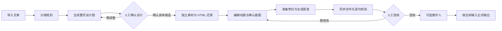

# HTML 工作区功能闭环与 Stitch 布局交接

2026-10-15，Asia/Shanghai。基线 main `7238aa3515e809bd4f7cf2789bd08ce78e9e1f24`；代码提交 `fa5488ab2cba88fc99a21e21ea4f4e2323678429`，发布目标为 origin/main（PPT_HTML_Studio）。契约包0.9.46，规范入口为 [工作区流程0.1.0](../../contracts/html-presentation/runtime/visual-v1/html-workspace-flow-0.1.0.md)。本记录接续前一日的界面整理与 [适配审核](../../reviews/2026-10-15-html-workflow-fit-audit.md)，不将真实课程签收登记为已完成。

## 用户流程与职责

整页设计图解决构图与风格；独立配图是图片素材；文字、图形、箭头和注册关系对象由代码还原。分镜负责每句的表达和动作，配音负责实际时间，人工分别确认设计、画面、音频和核验。无独立 HTML 勾画/数据素材步骤；当前自动主体预算、注册动作与标题模板边界保留，不承诺自由手写、通用图表或任意无标题模板。

## 已实现增量与归属

| 归属 | 最终行为 | 关键验证 |
|---|---|---|
| html_workflow_state / flow / courses | 当前设计、页面批准、音频、A04、当前视频独立投影；历史完成位不替代当前事实；首页按各步骤真实状态着色 | 状态/当前输出/迟到读取/失败清理回归；真实两项目状态读取 |
| html_review_panel | 设计与实际页面分开的3/5路由；已确认原图可回看；保留原候选key；单一主要确认操作；缺少页面有前置入口 | DOM21项；设计身份、独立按钮、图片后端恢复 |
| html_audio_review | 现有编辑预览服务返回 audio_timeline 绑定场景；音频时间驱动共享播放器；绑定字幕定位；切页/项目/步骤停止；编辑旁白后停止旧试听 | 隔离真实共享播放器＋合成静音WAV：seek/字幕/播放时钟差＜80ms/停止保持；独立fixture控制测试 |
| narration_audio | HTML音频槽位来自权威旁白页面，不读取旧图片列表；首次同步旁白入口可见；TTS完成刷新当前试听 | 项目归属/HTML无图片请求；原图片音频显示恢复 |
| html_semantic_qa / event_bindings | 逐句画面核验位于配音页；前置缺失/未知原请求禁止新提交；人工决定独立；音频确认未完成同步则留在此页 | 缺场景/音频/绑定、未知请求、报告缺失、人工说明、失败语义与恢复测试 |
| output_render | MP4前置缺项明确显示并返回对应步骤；读取失败禁用；当前输出与导出就绪分开 | 前置/导航/读取失败/图片恢复DOM回归 |
| html_workflow.css | 复用 Stitch 原稿紧凑导航和主预览/审阅栏；小屏单列、横向步骤条、顶栏不遮挡；编辑器/首页/输出等共用布局规则 | 正常应用七面板×1280/768/420无横向溢出与顶栏遮挡回归，真实页面视觉逐步核验 |

没有数据库、公共请求/响应Schema、生产Prompt、作者场景或批准格式修改。新预览POST仍是既有只读编译/绑定接口，不触发生成或保存。现有恢复、未知结果核实、人工修改冲突和正式输出门禁保持。

## Stitch 证据与来源

使用 stitch::generate-design 及 StitchDesign 的系统指导。既有私有项目 `8494304199748819775`；原设计、还原、配音稿及下载HTML/PNG已保存于 `.stitch/screens.json`、`.stitch/designs/`。本地 `.stitch/DESIGN.md`记录实现准则，未上传或创建新项目级设计系统。

新的四屏编辑请求发生传输失败；随后读取屏幕清单未发现新稿，未盲目重发。当前布局是对既有 Stitch 原稿的代码适配，不冒称获得了新的生成结果。旧稿流程标签与业务不符的部分由本次规范替换。

## 工程检查

- Python联合回归：creation_workflow / course_jobs / audio_binder / semantic_qa / model_binding_integration / design_reconstruction，**67 passed（46.37秒）**。
- 原缓存/人工冲突用例夹具补入设计provider、设计停点和显式接受；两个阶段都验证不提前改作者场景，规划复用和人工冲突断言保留。没有放宽生产设计门禁。
- 旁白UI/手动暂停/步骤归属：**36 passed**；旁白跨项目JS与新增HTML页面音频来源检查通过。
- 正常应用导航覆盖七工作区及1280/768/420；首次旁白入口可见，未就绪输出被阻断，导航不提交生成/批准，切回图片恢复。
- 面板21项、逐句核验、输出前置、事实投影、可见流程、同步试听fixture、实际共享播放器联播、frontend quality、Agent生成文档一致性与focused diff空白检查通过。
- 隔离测试使用HTTP doubles或合成音频；不能登记为实际TTS、模型还原质量或整课视频通过。历史交接记录的Agent planning结果字段缺口未改公共API，仍需独立处理，未声称完整Agent suite通过。

## 真实项目与运行备注

本机A06项目 `8ce1222f_194645`：五页分镜，第一页设计待确认；其余设计、HTML、TTS、A04和完整视频仍未通过。原父任务 `html_903b91bbf2ec43c1b64b` 与设计子任务 `html_c137f14ae393487fa54f` 保留。不能自动批准或将旧unknown重发。

旧 `c16bc2b3_203534` 有HTML作者场景但音频过期；真实工作区显示已过期并阻止联播，旧完成位不再抬高首页进度。

验证期间发现8010服务已停止；只读核对原数据库含两个项目、active_jobs=0、端口无监听后，从 canonical checkout 用start_server.py恢复127.0.0.1:8010。显式使用原 data/projects.db 与 runs，无运行副本、测试数据或凭据搬迁。前端文件实时读取且无缓存。

## 接续验证

真实课程仍需用户审阅当前设计，再按原key还原、逐页确认画面、生成实际配音、试听、A04及人工签收后导出。软件工程验证与每次课程的人类判断分开。布局视觉检查证据存于ignored outputs/a06-local-normal-20261014，后续补充实际截图与完成审计；不将未核验页面或供应商结果记为完成。

## 发布备注与代码审核

本次发布覆盖工作区流程、当前状态投影、音频驱动画面试听、输出前置提示及布局；没有自动批准课程。A06仍在第一页设计待确认，实际TTS、逐页核验和完整视频待继续验收。未知供应商请求须核实原结果，不能重复提交。

五维审核：正确性由当前事实、迟到请求隔离、未知请求禁重发及图片恢复回归验证；职责分别位于状态、审阅、试听模块；动态文本使用文本节点，试听仅加载既有第一方播放器；不增加公共API或凭据；首页并发限制为3，音频高亮仅在句子切换时更新。上述范围未发现阻断发布的问题。

实际桌面文章、分镜、设计页已有截图；七工作区三种宽度通过隔离浏览器检查，其余真实页面视觉与整课质量仍需继续核验。测试音频为合成静音WAV，不是实际课程配音。

发布记录：代码提交 `fa5488ab2cba88fc99a21e21ea4f4e2323678429`；交接文档另行提交并随代码一并推送。Stitch HTML参考稿与元数据入库，PNG及实际运行截图保留在本机忽略目录。凭据、数据库、runs、outputs与logs均不入库。
