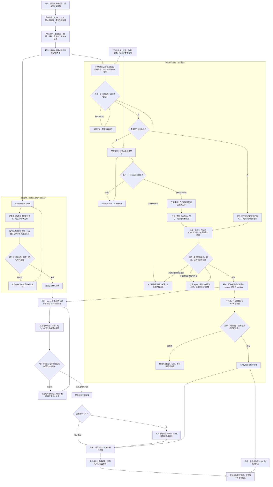
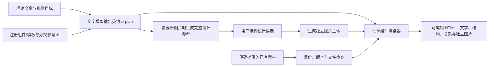
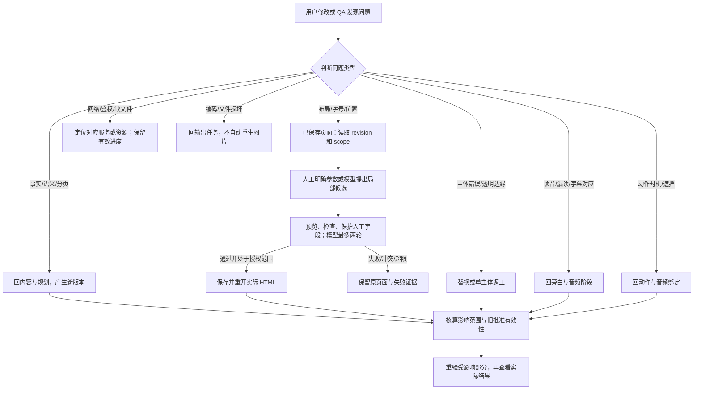
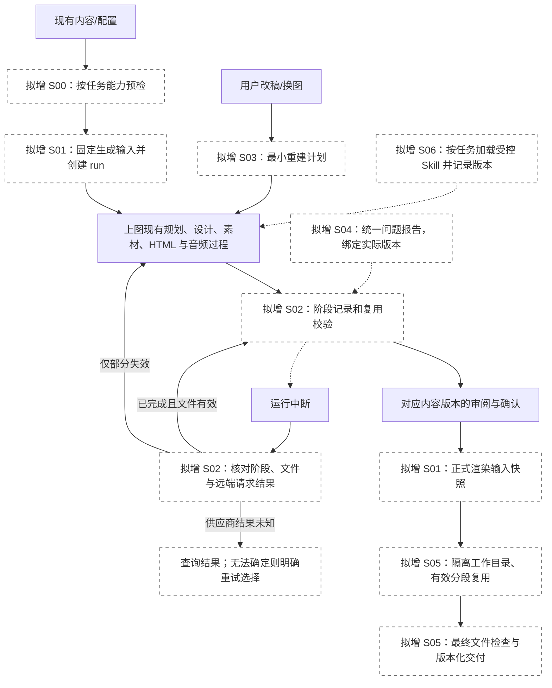

# HTML 制作整体流程图：审核稿

2026-10-12。供流程审核，未启动稳定性改造。适用当前 HTML + 16:9 路线。现有组件库、模板库、默认黑灰白风格及音频服务作为基础。

本稿描述实际模块分工及拟优化流程，不表示全部路径已经真实验收。当前只有指定案例的自动初稿与二次编辑验证，完整课程、真实新生图供应商、声音与导出仍需分别验收。业务流程图不重排应用八个可见工作区位置。

## 1. 完整制作流程

这张图沿用现有生产分工：模型规划、注册组件渲染、局部修复、独立音频与输出门禁。设计/实际画面/音频/节奏的审阅可以按一组页面集中进行；普通技术步骤不增加人工确认。内容规划与整段交付的统一持久审阅记录仍未实现。

**图中失败分支的补充规则：** 结构纠错次数按现有服务上限；不会无限回到同一节点。独立图片失败只返回对应素材任务，不自动重做所有页面。绑定失败保留 scene 与有效音频，定位 beat/对象错误。H3/音频/动作修改可导致旧指纹失效，按当前门禁重新核验。正式合成、完整听审与 PPTX 打开是需要执行的验收动作，并非看到图就已完成。

**音频和画面的依赖：** 音频可以先于 HTML 准备。动作可在作者时钟下做草稿预览，但图中正式有声联调必须有实际保存场景和当前确认音频。图中的 H5 是节奏审阅流程；现有导出 API 技术门禁以实际合同为准，不能把图里的接受自动当成新增审批字段。

## 2. 生图和可编辑代码之间的关系

完整设计图指导外观，不是正文数据源。准确文字来自 plan，程序按注册布局组装；没有通过 OCR 从整张图恢复任意 HTML 的默认路径。图片自身的像素通过换素材或重生成修改；HTML 中的文字样式、对象位置和受支持动作通过编辑器修改。

现行约束：注册模板决定槽位及容量；生图参考须服从支持范围。计划不可执行时回到规划/能力定义，不能让 Agent 通过任意 CSS 硬凑。新图片设计确认与实际 HTML 视觉确认是两个不同对象；纯代码或仅复用已有素材的页面直接展示实际 HTML。

## 3. 修改和失败后返回哪里

现有服务已有部分失效、缓存、人工保护和冲突逻辑；完整的阶段依赖与最小重建计划为 S03 待实现。不能由此图承诺目前所有导出都已按页缓存复用。语义修改需要从权威内容重规划，不属于字体/位置 patch 的权限。

## 4. 拟增加的稳定性外层

以下虚线框节点均为待改造能力，并不要求用户多确认技术步骤。

图中阶段记录是各实际阶段的旁路账本，不表示整条生产结束后才记一次。恢复使用原 run 和冻结输入；输入变化则建立新版本/run，并核验能否复用已有有效产物。

## 5. 各交接点的输入输出

| 交接 | 输入 | 输出与责任 |
| --- | --- | --- |
| 内容 → 规划 | 页面目标、准确文字、旁白、语块 ID、素材声明 | 文字模型选择注册模板与对象；程序校验 plan |
| 规划 → 设计 | plan、真实分类参考、主题描述、槽位几何 | 生图模型输出完整设计候选，仅作为参考 |
| 设计 → 素材 | 用户选定设计、主体要求、已有资源 | 独立主体或校验后的复用资产；程序检查身份与边缘 |
| 规划/素材 → HTML | 注册模板、scene 数据、资源、人工覆盖 | 程序渲染实际 HTML，模型只提出受限修复 |
| 旁白 → 音频 | 当前朗读文本、声音/读音配置 | 已有服务生成音频；程序校验音频/字幕时间对应；用户试听 |
| HTML/音频 → 动作 | 保存场景、稳定目标 ID、确认的语块时间 | 程序解析 binding，实际有声预览；人工/模型调整受支持动作 |
| HTML → PPTX | 当前有效场景与视觉批准 | 快照图片 PPTX；不能声明为原生文字/对象可编辑 PPTX |
| HTML/音频/动作 → 视频 | 当前视觉批准、音频确认、合法 binding、可选数字人 | 实际 MP4 与检查记录；拟增正式快照、分段恢复和完整交付账本 |

## 6. 审核时优先判断的五个问题

1. 规划先落到注册模板，再生成设计参考的顺序是否满足创作需求；设计自由度受执行能力约束，不能假定参考图的任意构图都能还原。
2. 新图片路径分别审设计参考和实际 HTML 是否合理；纯代码/复用素材路径无需额外整页生图。
3. 音频与画面可以分别推进，正式有声联调等待两者当前版本就绪。
4. 内容、图片、排版、音频、动作和导出的问题分别返回对应阶段；不将所有问题交给排版 Agent。
5. HTML、快照 PPTX 与视频有不同交付能力与前置条件；是否符合实际使用目标。

审阅意见应注明节点及修改方向，再调整本图与实施方案。流程确定后，才实施 [S00—S08 改造](html-production-stability-2026-10-12.md)。
