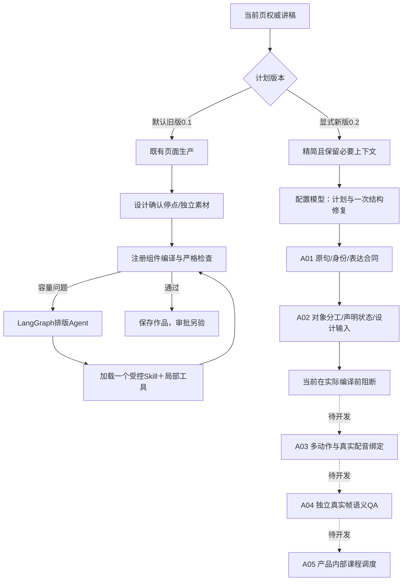

# Agent、Skill、输入上下文与流程审核

2026-10-13。范围：当前本地A01基础上的A02；入口追踪到实际模型调用、解析与下游消费者，非仅文档评审。

## 结论

现有受限排版Agent架构可保留。当前仅排版修复是LangGraph＋受控Skill；语义规划是最多一次结构修复的JSON模型服务。整体课程制作仍未完成产品内部自动编排，不能称为全流程Agent已经跑通。应先完成表达合同/实际动作/独立QA，再扩展调度；本轮未增加新的框架或自主Agent。

## 审核问题与处理

| 问题 | 影响 | 本次处理 |
|---|---|---|
| 语义规划原样发送visual_groups、beats、brief | 重复讲稿、内部字段和完整效果目录占用上下文 | planning_context白名单；精确去重，保留独立屏幕文案及素材身份 |
| 规划只有槽位名称/kind，没有真实尺寸和行数 | 选择结构时缺少容量依据，易把问题拖到字号修复 | 新Prompt加入按布局版本解析的box/maxLines |
| A01信息未进入design_brief/reference_package | 生图只看静态内容，原意图和分步状态丢失 | A02分工及逐句状态投影进入brief与实际参考包/Prompt构造 |
| actionId只检查本页唯一，未检查结构修复改名 | 有界修复会无意改变动作身份 | 同一动作已合法身份必须保留；非法重复身份可修正 |
| 原输入错误直到模型返回才发现 | 可能消耗两次无意义请求 | 源ID/原句/预算等在模型调用前预检 |
| 结构诊断既在system又在user；Pydantic错误带原输入 | 修复上下文重复、杂乱 | 具体诊断只在user；限8条、不回显整段input_value |
| 排版Agent主题/布局仅按ID选择 | 存在多版本时可能使用错误尺寸/文字默认 | id+version唯一匹配；缺失明确失败 |
| 操作Skill未说明A01/A02路线，案例版本落后 | 操作助手可能把含义问题误送排版循环 | Skill1.8.0按需引用语义规划指南；28条结构化路由案例 |

## 最小且必要的上下文

| 信息 | 是否进入模型 | 用途 |
|---|---|---|
| 当前页原句＋beat ID | 是，每句一次 | 语义真值和映射身份 |
| 与讲稿不同的屏幕文字 | 是 | 保留用户明确的屏幕表达，不擅自改写 |
| 视觉约束、已有素材id/version/说明 | 是 | 表达分工与允许复用身份 |
| 注册模板/kind/字段/实际槽位预算 | system | 让模型知道合法且可容纳的结构 |
| 当前视觉意图、对象作用、预期表达 | 设计阶段 | 说明每句与哪些对象相关；不同于逐字屏幕文案 |
| 原计划hash、原句hash、日志路径、音频路径 | 否，保存在证据 | 审计/失效检查由代码完成 |
| 整个Skill目录、全部效果目录 | 否 | 当前规划没有消费者，不提供虚假的执行能力 |
| 排版时的全部当前对象/邻居几何、公开parts、人工保护 | 保留 | 仅给错误对象会缺少遮挡、关系和保护上下文，不能机械压缩 |
| 全课原文、其他页、历史成功案例全文 | 否 | 当前单页决策不需要，跨页语义需求将来须显式定义 |

五页固定Token输入的user JSON从6384降至4944 UTF-8字节（减少22.6%）；全部原句未变。这里只量user载荷，不是token数、费用或速度；system另增加必要布局预算，不能把此数字说成总成本下降。测量见[a02-input-audit](2026-10-13-a02-input-audit.json)。

## 真正运行的流程

图中的新版步骤是实际接口与纯服务，虚线部分尚未实现。A02声明可见性是按动作列表推导，无真实秒数；不是浏览器观察。模型仍可能写出形式完整但表达错误的声明，A04必须验证原句与真实帧，不允许生成者自称正确就批准。

## Skill判断

运行片段candidate-layout-repair0.1.0的范围、工具边界、人工保护和按需引用合理，本轮不改其正文或已验证的系统提示词，不把三样本历史成绩推广到语义规划。修复Agent的实际出站Prompt/图片散列与loader内容散列可追踪。

Codex的produce-editable-html1.8.0是操作手册，新增语义规划按需参考。它不自动作为豆包system消息；六项职责仍是职责，不是六个已运行的Skill/Agent。28个facts路由测试能证明结构化路由，不证明自然语言理解正确。

## 剩余风险与下一步

1. 本轮真实豆包单页一次调用通过结构，但逐句讲解对象都被标为context；这仍需语义审阅，不能认可为角色判断正确。上一轮90秒未返回的原始失败保留；本轮不是对同一输入重试，也不能据此证明成功率或提速。
2. 当前图片只有whole_asset控制；内部概念分割、锚点与多主体适配没有因A02而自动获得。
3. A03完成前不能解除新版编译阻断；A04完成前不能签发语义通过；A05完成前不能把开发脚本称为产品自动制作。
4. 继续保留原模型连接绑定、供应商unknown处理、源码/输入快照、人工字段及正式导出门禁。未知响应不会因为更换框架而消失。

验证结果与真实模型记录见[本轮handoff](../plans/html-backend-development/handoff-a02-2026-10-13.md)。
